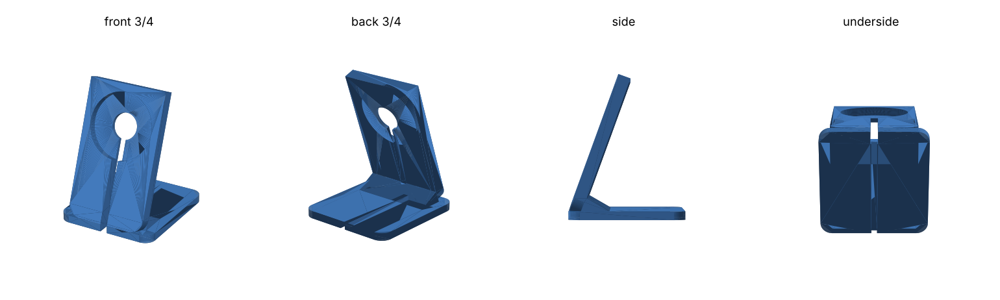

# MagSafe / Qi2 phone stand

A 3D-printable desk stand for the **Amazon Basics 25W Qi2.2 wireless charging pad**
([B0FPDWY9QD](https://www.amazon.com/dp/B0FPDWY9QD), model LACC175). The idea comes from
[Apple iPhone MagSafe Stand](https://www.printables.com/model/44465-apple-iphone-magsafe-stand):
an angled plate holds the charger puck in a pocket, with a hole behind it for pushing the puck out.

## Files

- `magsafe_stand.scad`: the parametric source (OpenSCAD 2021.01 or newer, Customizer supported)
- `magsafe_stand.stl`: ready to print with the default parameters

## Design

| | |
|---|---|
| Overall size | 92 × 100 × 124 mm |
| Plate tilt | 70° from horizontal |
| Puck pocket | Ø 60.3 mm × 7.5 mm deep. The puck sits 0.6 mm proud so the phone touches it. |
| Puck centre | 88 mm up the slope, so a 6.9" Pro Max still clears the desk in portrait |
| Push-out hole | Ø 24 mm, through the plate |
| Cable path | A 6.5 mm slot runs from the hole down through the plate. A 5 × 4.5 mm groove under the base leads out the back. The path is open everywhere, so the USB-C plug never has to thread through. |

The cable path works whichever way the cable leaves the puck:

- **Edge exit:** turn the puck so the cable points down into the slot.
- **Back exit:** feed the cable through the push-out hole and down the slot.

## Printing

- Print flat on the base, as exported. No supports needed.
- PLA or PETG, 0.2 mm layers, 3 walls, 15–20% infill.
- You can stick rubber feet or double-sided tape under the base.

## Fit

The listings give the puck as 59.9–60.0 mm across and 8.1 mm thick. **Measure yours with
calipers** and set `puck_d` / `puck_h`.

The phone's magnet pulls on the puck, so a loose puck will come out with the phone. Fix this by
lowering `fit` to 0.1–0.2 for a press fit, or by putting a thin piece of double-sided tape on the
pocket floor.

Other useful parameters: `angle`, `puck_c` (raise it for taller phones), `plate_w`, and `base_d`.

To export after editing: `openscad -o magsafe_stand.stl magsafe_stand.scad`
